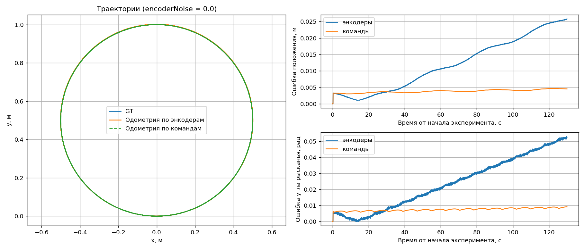
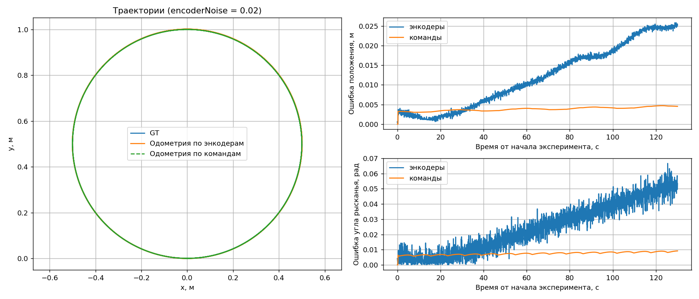
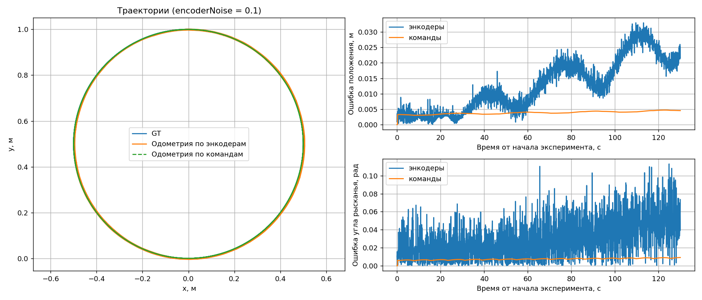

# Практика 03
## Структура проекта
``` text
practice-03
└── odometry_study
    └── expirement_recorder (запись одометрии, запись энкодеров, создание графиков + запись CSV)
    └── ground_truth (файл из примера)
    └── cmd_publisher (публикация состояния в cmd_vel для подсчета    одометрии)
└── launch
    └── expirement.launch.py (лаунч файл для сборки всего)
└── protos (папка с прото-файлами)
└── resource (здесь лежат URDF-файлы робота, супервизора и ros2-control.yaml)
└── results (три картинки графиков и три файла CSV с разными параметрами шума)
└── worlds (файл со сценой нашего проекта)
└── run_all.sh (файл с запуском лаунч файла с тремя разными параметрами шума. запус друг за другом поочереди)
```

## Сборка и запуск
```bash
cd ~/practices_ws/src/practice-03
colcon build --packages-select odometry_study
source install/setup.zsh
ros2 launch odometry_study experiment.launch.py noise:=0.1 results_dir:=$PWD/results
# все три эксперимента подряд:
bash run_all.sh
```
Параметры: `noise` (encoderNoise, рад), `duration` (длительность в секундах симуляции), `results_dir`.

## Параметры эксперимента
- Движение: linear.x = 0.1 м/с, angular.z = 0.2 рад/с (радиус 0.5 м, период ≈ 31.4 с), длительность 130 с (≈ 4 круга).
- Арена 6×6 м, старт в (0, 0, yaw 0).
- Параметры diffdrive_controller: wheel_separation_multiplier = 1.11

## Результаты
| encoderNoise | график |
|---|---|
| 0 |  |
| 0.02 |  |
| 0.1 |  |

## Анализ
Без шума одометрия по энкодерам дрейфует: ошибка угла растёт линейно, примерно на 0.0004 рад/с, а ошибка положения за 4 круга достигает 2.6 см. Одометрия по командам в симуляции получилась точнее, потому что робот хорошо выполняет заказанные скорости. Но она вообще не измеряет фактическое движение, поэтому на реальном роботе её ошибка росла бы значительно быстрее, например из-за проскальзывания.

С ростом шума меняется не систематический дрейф, а разброс. Шум добавляется независимо к каждому отсчёту угла колеса, а одометрия считается по приращениям этих углов. Амплитуда дрожания растёт пропорционально σ: при 0.02 рад ошибка угла колеблется примерно в пределах ±0.01 рад, при 0.1 рад — до 0.1–0.13 рад. При этом значения придерживаются нужного пути с отклонениями.

Основной вклад в ошибку одометрии по энкодерам даёт калибровка модели: подбор wheel_separation_multiplier уменьшил ошибку положения в 3.4 раза, а ошибку угла в 3.5 раза (0.089 → 0.026 м и 0.18 → 0.052 рад). Шум энкодеров 0.02 рад почти не меняет картину, шум 0.1 рад делает оценку угла заметно «шумной», но систематический дрейф при этом не увеличивается.
